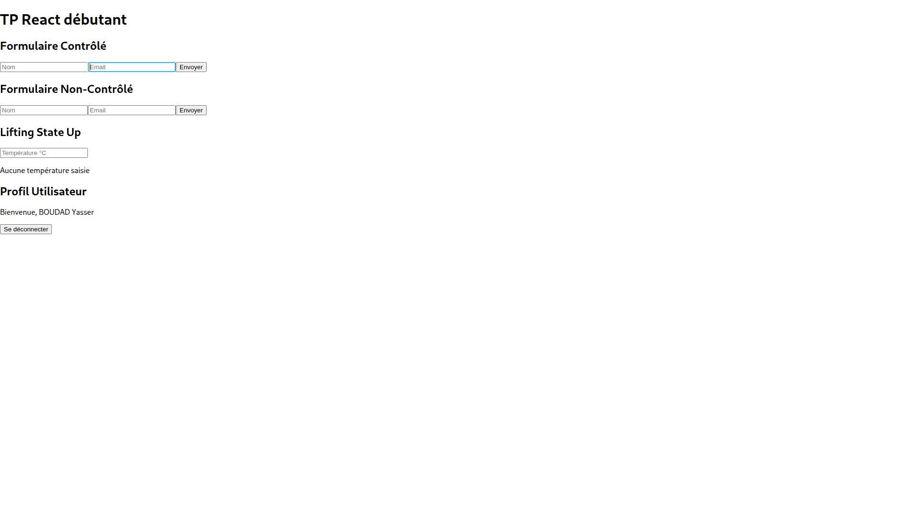
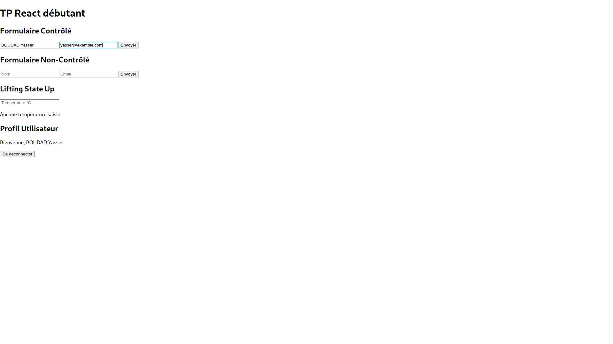
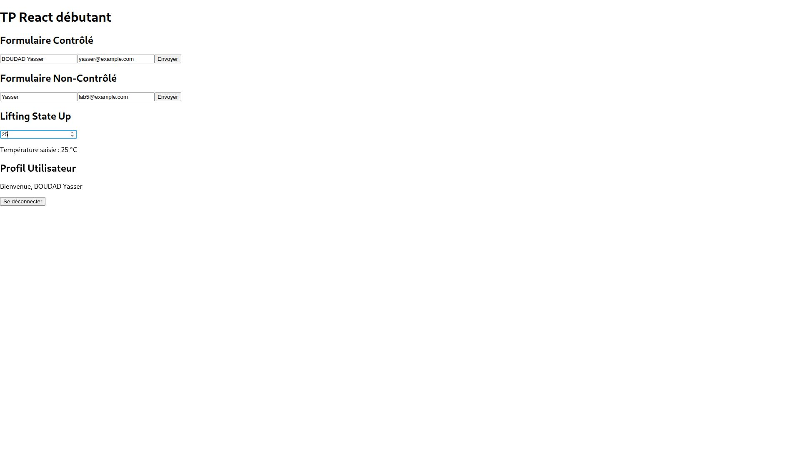
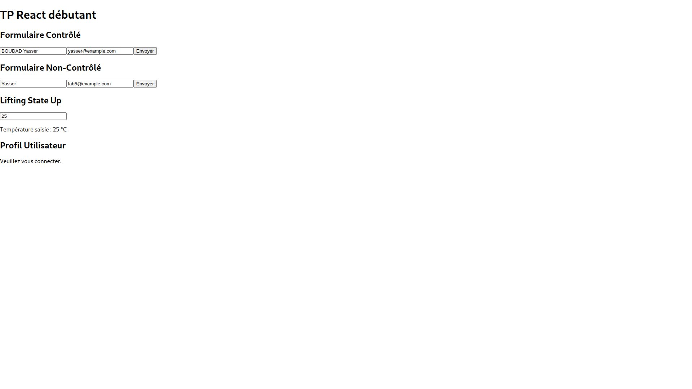

# Lab5-tp-react-debutant

**Réalisé par : BOUDAD Yasser**

Formulaires contrôlé et non-contrôlé, température et contexte utilisateur.

Formulaire contrôlé rempli avec un nom et un email.

Formulaire non-contrôlé rempli et température affichée à 25 °C.
Les deux formulaires affichent les valeurs saisies dans une alerte.

Après déconnexion, « Veuillez vous connecter. » remplace le message de bienvenue.

